# MirrorLine Mobile User Flows

## 1. Launch, optional update check, and session routing

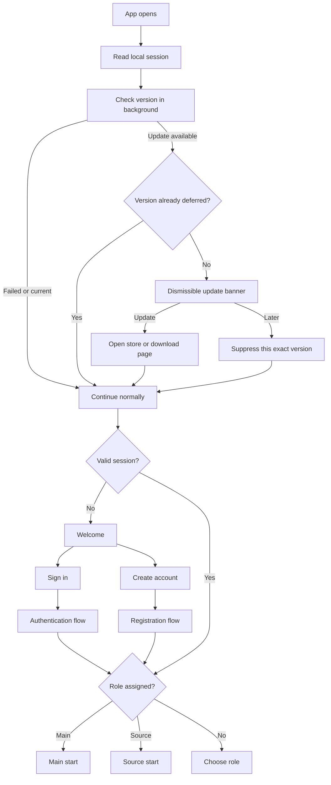

## 2. Registration and email verification

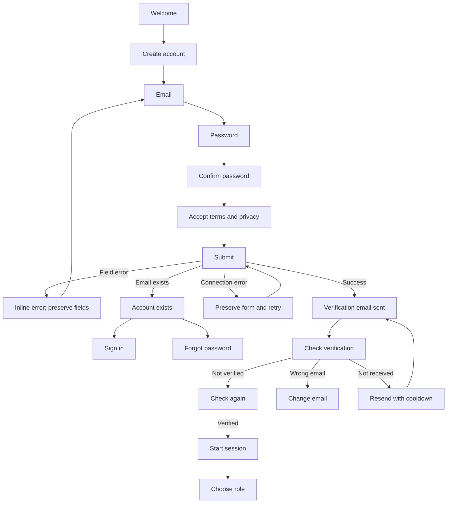

## 3. Sign in and password reset

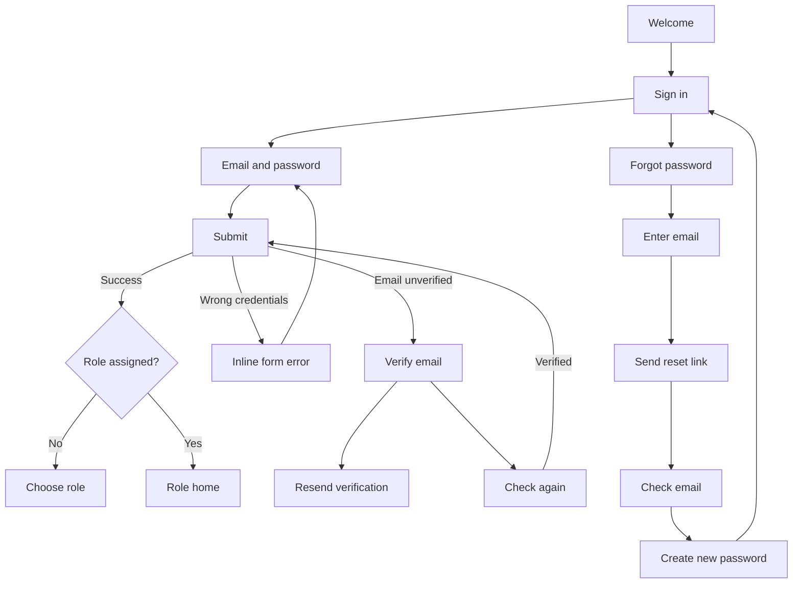

## 4. Main Phone setup and secure replacement

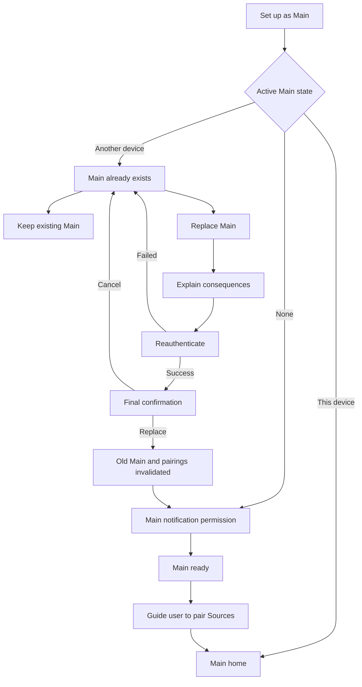

## 5. Add Source from Main

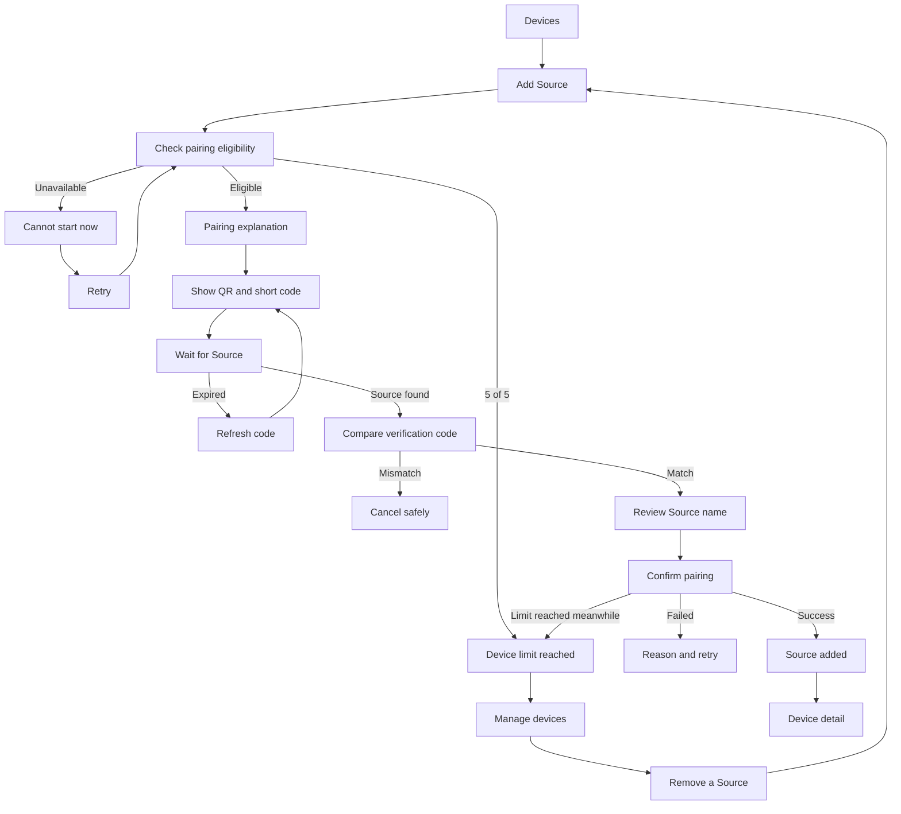

## 6. Pair Source to Main

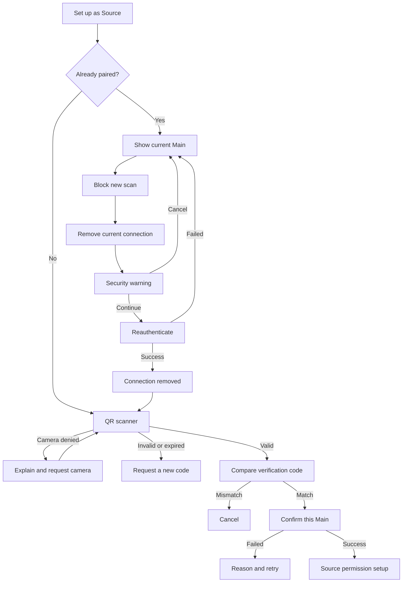

## 7. Role-specific permissions

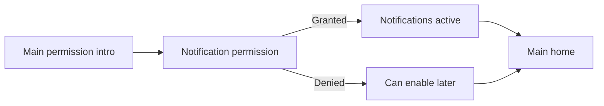

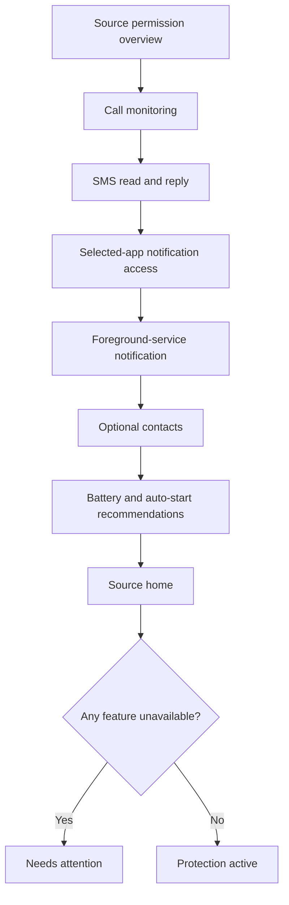

At every Source permission step, Granted enables the feature and Denied marks
only that feature Disabled or Limited. Pairing remains intact.

## 8. Main and Source navigation

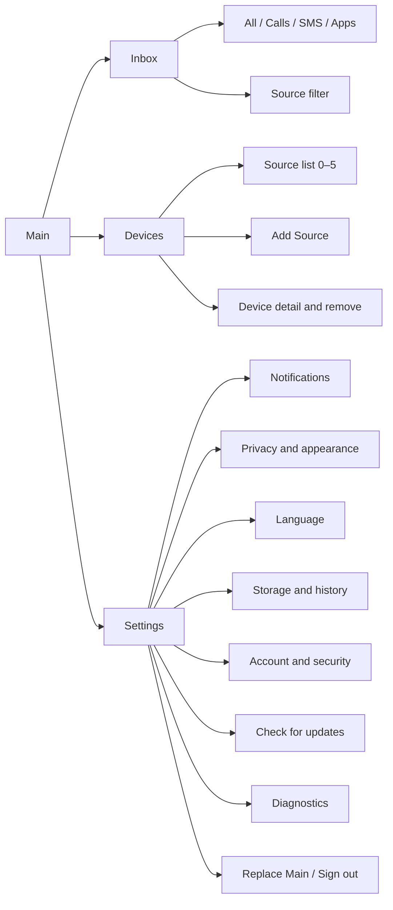

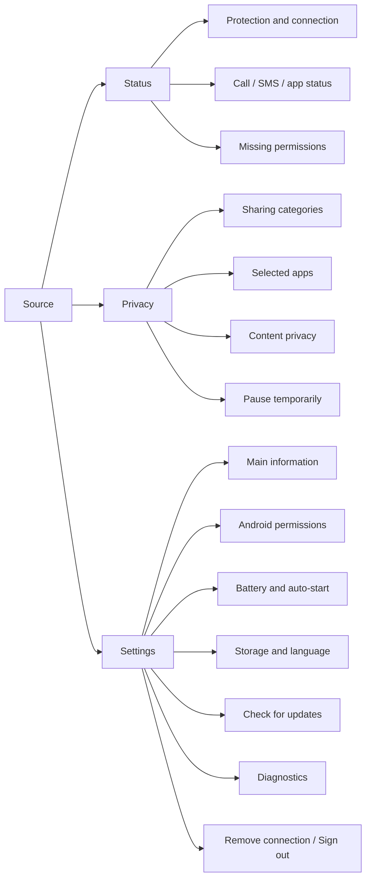

## 9. Update check

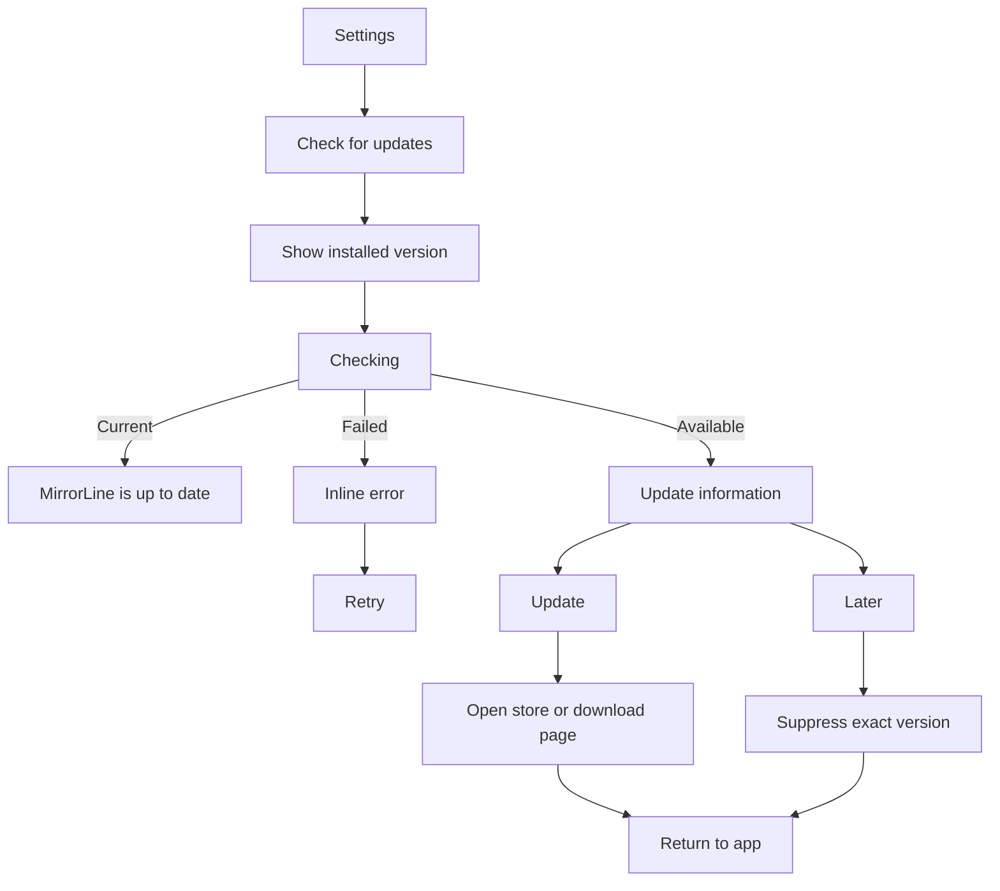

## 10. Inbox and conversation pagination

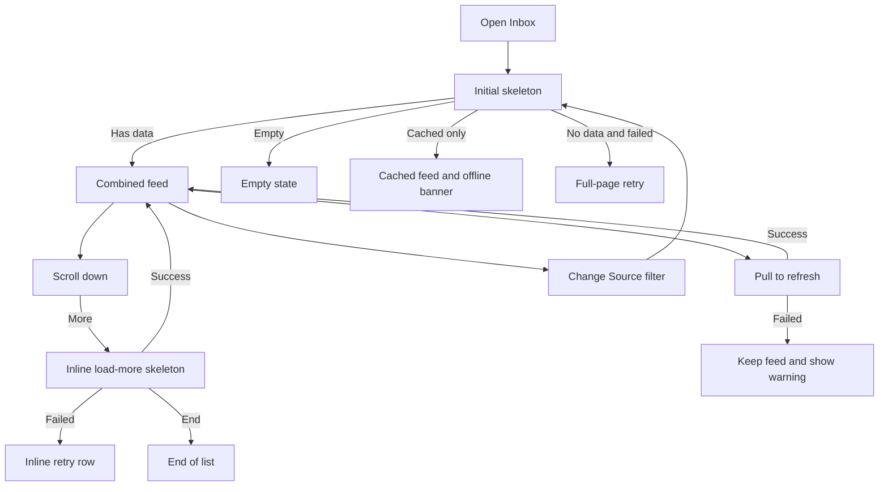

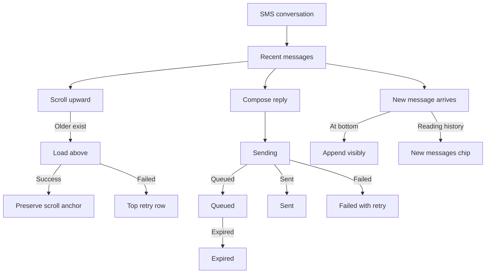

## 11. Event detail and feedback hierarchy

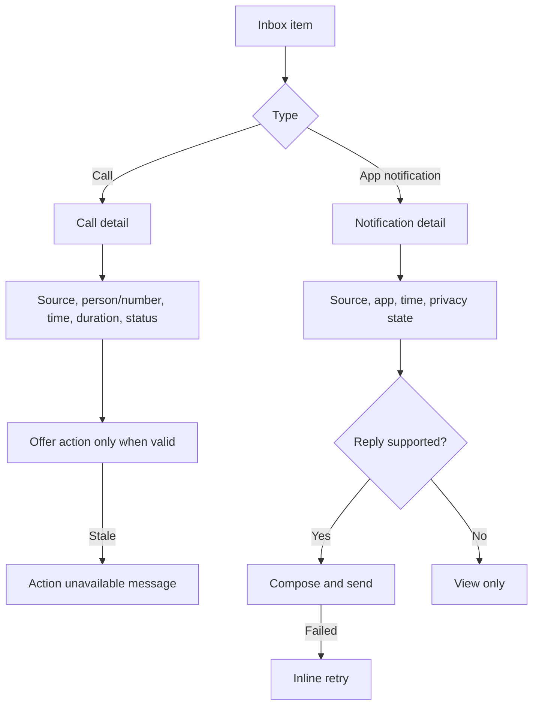

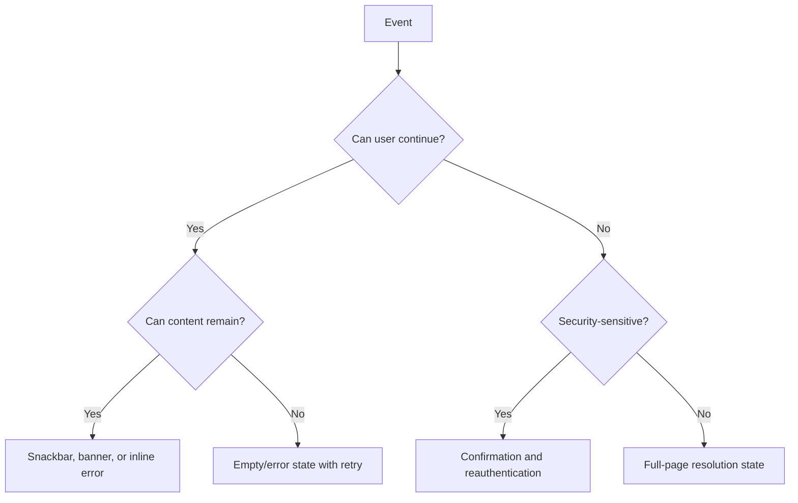
